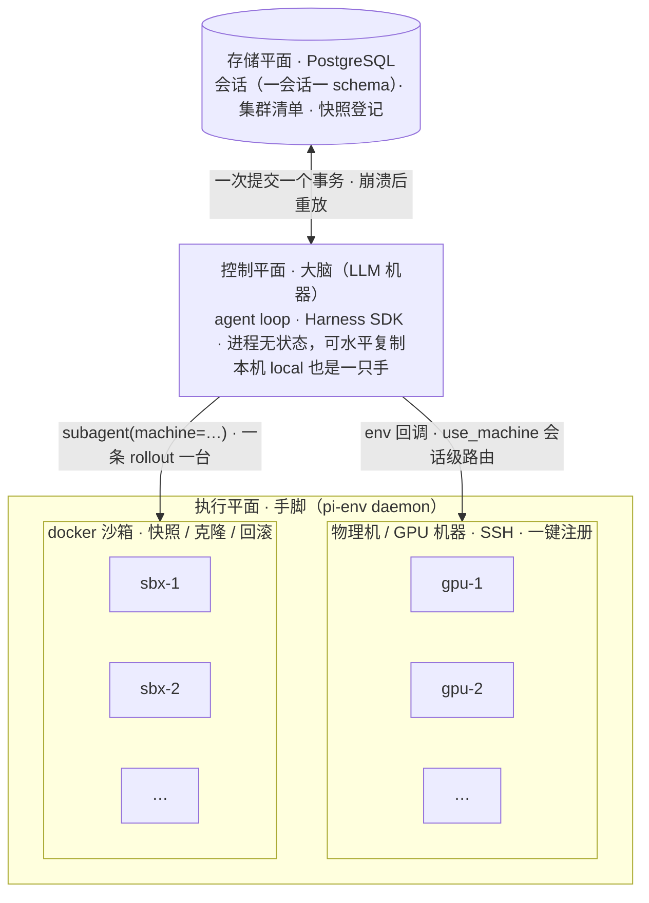

# pi-distributed

**一个大脑，多双手。**

pi（[earendil-works/pi](https://github.com/earendil-works/pi)）的分布式实验分支，只做一件事：把 LLM 大脑、干活的机器、会话记录三者解耦，各自独立伸缩。

模型在你 Mac 上思考，命令派往任意机器——本机、SSH 远端、随起随销的 docker 沙箱；对话与集群状态落进 PostgreSQL。用起来仍是普通 agent：`read` / `write` / `edit` / `bash` 四件套一行未改，只是底下的接线不同。

*One brain, many hands — a fork of [pi](https://github.com/earendil-works/pi) where the model, the machines it works on, and the session log all live in different places.*


## 架构

三个平面，各管各的：



手脚是每台机器上的 `pi-env` daemon，大脑通过它派发 read/write/edit/bash。切机器只有两个入口：对话里 `use_machine`，或开子 agent 时指定 `machine`。机器清单、快照、聊天记录只存在于 PG——没有本地配置文件，大脑崩了换台机器接着跑。

## 为什么拆开

普通 agent（包括 pi 本体）是三合一：大脑、文件系统、聊天记录焊死在一台机器上。拆开之后，两件事立刻成立：

**一个 agent 管一堆机器。** 对话里说“去 gpu-box 跑个训练”，bash 就在 gpu-box 上执行；说“切回本地”，下一条命令又回到本机。切换是会话级的——持久化在数据库里，重启进程还停在原来那台机器上。加一台机器 = 往表里插一行。

**给 Eval / RL 铺路。** 主 agent 并行开一批子 agent，每个绑一台机器、或一个从快照克隆的沙箱，跑 rollout / eval。每个子会话都是完整的 durable 记录：中途挂了能续，事后能复盘；配合快照与回滚，环境也能回到任意检查点。

状态全在数据库，大脑进程便没有状态——想开几个开几个，塞容器、接队列调度都行。“支持大规模分布式”的全部秘密就这一句：别把状态焊在进程里。

## 工具设计：主 agent 管集群，子 agent 只管干活

工具按角色分两层。主 agent 是编排者：管集群、控制机器时间线、派发任务；子 agent 是执行者：钉在被分配的那台机器上干活，别的什么都碰不到。分层的理由：子 agent 跑的是模型生成的任务代码，不可信——把快照/回滚这种时间线控制权交给它，等于交给它销毁现场、篡改证据的能力（reward hacking 在生产环境有真实案例）。主 agent 同时看得到对话和环境两条时间线，回滚之后环境状态和对话记录的一致性由它负责。

**主 agent（根对话）**

| 类别 | 工具 | 说明 | 状态 |
| --- | --- | --- | --- |
| 执行 | `read` `write` `edit` `bash` | pi 原生四件套，跑在本对话当前机器上 | ✅ |
| 路由 | `use_machine` | 切换本对话的执行机器，会话级、存 PG、重启不丢 | ✅ |
| 集群 | `list_machines` | 集群点名：名字、类型、状态 | ✅ |
| 集群 | `create_machine` | 往集群加机器：默认起 docker 沙箱，`from_snapshot` 从快照克隆；`type: "physical"` 生成物理机的一次性安装命令（内嵌公钥 + 令牌），目标机跑一次自动入队 | ✅ |
| 集群 | `destroy_machine` | 销毁沙箱 / 注销远端机器（它的快照保留，仍可克隆） | ✅ |
| 时间线 | `snapshot_machine` | 给机器当前状态打快照，快照登记进 PG，所有会话共享 | ✅（docker commit 兜底） |
| 时间线 | `rollback_machine` | 机器回滚到快照；工具输出会明示时间线已回退 | ✅（docker commit 兜底） |
| 派发 | `subagent` | 派任务（前台阻塞，返回孩子最终答案）或后台跑（`background` + `name`：立即返回，`wait` 收割、`stop` 停止、完成自动报告，跨 abort 与重启存活，每会话预算 64）；按名字续聊；创建时指定机器，配合克隆做到一条 rollout 一台机 | ✅ |
| 派发 | `list_subagents` | 列出本会话的命名子 agent | ✅ |

时间线工具吃后端能力：docker 类型先用 `commit` 慢快照兜底（只有文件系统态，进程和内存不保存，恢复后要重新拉起服务），micro-VM 后端（Gondolin / CubeSandbox 类）才有 O(1) 克隆和含内存态的快照；ssh 物理机没有虚拟化层，不支持快照，工具会明说。

**子 agent（子对话）**

| 类别 | 工具 | 说明 | 状态 |
| --- | --- | --- | --- |
| 执行 | `read` `write` `edit` `bash` | 钉在创建时分配的机器上，全程不能换 | ✅ |

就这四个，没有别的：不能切机器、不能增删集群、不能碰快照、不能再派发——创建子对话时把 `subagent`（防递归）和 `multi-env` 两个扩展全部移除，集群控制在结构上就够不着。换机器或重来一次的权力在主 agent：新开一个子 agent，或者回滚机器再重新派发。

**系统层（不是工具，任何角色都调不到）**

- env 回调按对话的 Machine 文档解析 ExecutionEnv——机器路由的底层接线
- 快照登记进 PG（`pi_machines.snapshots` 表），随系统提示的 machines 段落透出，不设单独的 list 工具
- 后台子代理的完成看守：宿主盯住它的 submission，答案写回 Subagents 文档并向父对话报告（父忙则排队、父闲则唤醒）；重启后从文档自动重挂，通知不丢
- 回合边界自动检查点（快照和对话记录对齐，服务崩溃恢复）🚧

## 现状

能跑的：

- 本机 + SSH 远端机器，会话级切换（切一次，之后所有工具调用都在那台机器上）
- 一键收编新机器：`create_machine(type: "physical")` 生成一条安装命令（内嵌公钥 + 单次令牌），目标机跑一次——装好 sshd、写好 authorized_keys、自动回调注册进集群（linux / windows 安装器都有）
- docker 沙箱：`create_machine` 起个容器就是新手脚（daemon 自动 `docker cp` 进去，SHA-256 校验后才运行），`destroy_machine` 销毁，`list_machines` 点名；alpine 实测通过
- 机器时间线（docker commit 兜底版）：`snapshot_machine` 打快照、`rollback_machine` 原地回滚、`create_machine(from_snapshot=...)` 克隆；快照存 PG（`pi_machines.snapshots` 表），比机器活得久；冒烟实测通过（快照 → 弄脏 → 回滚 → 克隆 → 重载）
- 子 agent：指定机器、并行跑、命名续聊（实测过两台机器同时跑）；子对话只保留原生四件套，集群工具在创建时移除，逃不出分配的机器
- 后台子 agent：`subagent(background: true, name: …)` 启动即返回；子对话 ownerless——父对话 abort、进程重启都不影响它继续跑；`wait` 收割答案、`stop` 显式停止、完成自动向父对话报告；faux 模型全链路实测（启动 → 收割 → 报告 → 挂起 → 停止）
- PostgreSQL 会话存储：一个会话一个 schema，进程崩了重启能续
- 机器清单存 PG（`pi_machines.targets` 表），动态增删；写了个不存在的机器名也不炸，自动回落到本地

还没做的：

- 大脑 daemon 化（TUI 与调度器分进程，后台工作跨进程存活）：等上游的 unix-socket client-server 实验成熟后跟进对齐，不自造协议
- Gondolin micro-VM 手脚（跑不可信代码的更强隔离，调研完毕待接入）
- O(1) 快照 / 含内存态的快照（等 micro-VM 后端；现在的 docker commit 兜底只有文件系统态，快照和克隆都是秒级全量拷贝）
- 回合边界自动检查点（快照和对话记录对齐，崩溃后“对话回放 + 环境回滚”一起还原）
- 远端机器的 daemon 升级（linux / windows 远端还没有 listFiles / PTY；windows 欠 ConPTY）
- 注册加固（公钥 `from=<IP>` 限定、回调限速）

## 与上游 pi 的关系

这是 pi 的分布式实验分支，不是替代品：

- 上游代码原样保留，定期 merge（当前跟到 v1.2.0，零冲突）。
- 新增的东西基本全在新文件里（多机路由、子 agent、PG 存储、机器时间线），上游源码几乎不动。
- 官方后来删掉了 durable demo，这个分支把它捡回来养着——所有扩展都长在它上面。
- pi 本身的问题去 [earendil-works/pi](https://github.com/earendil-works/pi) 提；这里只聊分布式这块。

## 快速开始

Node ≥ 22.19，外加一个 PostgreSQL（默认连 `postgres://pi:pi@localhost:5433/durable`，环境变量 `PI_PG_URL` 可改）：

```bash
git clone https://github.com/XavierWangHX/pi-distributed.git
cd pi-distributed
npm install
node packages/coding-agent/src/experimental/durable/main.ts
```

无头一轮（与官方 `-p` 同格式，也吃管道 stdin），会话照样落 PG、事后可查：

```bash
node packages/coding-agent/src/experimental/durable/main.ts -p "你的问题"
```

起来就能用——`local`（本机）开箱即有。加沙箱：让 agent `create_machine`（默认 docker）。加物理机：让 agent `create_machine(type: "physical")`，把生成的命令拿到目标机上跑一次（linux 是 `curl … | sudo bash`，windows 是管理员 PowerShell 里 `irm … | iex`），目标机自己装好 sshd、写好公钥并注册回来。

---

*以下为官方 pi 的 README，原样保留供参考（描述上游 monorepo 本身）。*

<p align="center">
  <a href="https://pi.dev">
    
  </a>
</p>
<p align="center">
  <a href="https://discord.com/invite/3cU7Bz4UPx"></a>
  <a href="https://www.npmjs.com/package/@earendil-works/pi-coding-agent"></a>
</p>

> New issues and PRs from new contributors are auto-closed by default. Maintainers review auto-closed issues daily. See [CONTRIBUTING.md](CONTRIBUTING.md).

# Pi

Pi is a minimal, extensible agent harness that you can make your own.

Adapt Pi to your workflows, not the other way around. Customize Pi with [extensions](packages/coding-agent/docs/extensions.md), [skills](packages/coding-agent/docs/skills.md), [prompt templates](packages/coding-agent/docs/prompt-templates.md), and [themes](packages/coding-agent/docs/themes.md). Bundle them as [Pi packages](packages/coding-agent/docs/packages.md) and share via npm or git.

Pi ships with powerful defaults but skips features like sub-agents and plan mode. Ask Pi to build what you want, or install a package that does it your way.

Use Pi [interactively](packages/coding-agent/docs/usage.md), automate it in [print or JSON mode](packages/coding-agent/docs/cli.md), control it over [RPC](packages/coding-agent/docs/rpc.md), or build apps with the [Pi TypeScript SDK](packages/coding-agent/docs/sdk.md). See [OpenClaw](https://github.com/OpenClaw/OpenClaw) for a real-world integration.

## Getting started

Install the command-line interface:

```bash
curl -fsSL https://pi.dev/install.sh | sh
```

On Windows:

```shell
powershell -c "irm https://pi.dev/install.ps1 | iex"
```

The installer pins all dependencies and updates Pi with `pi update`. Alternatively, install directly with npm, which does not pin transitive dependencies:

```bash
npm install -g --ignore-scripts @earendil-works/pi-coding-agent
```

Pi requires Node.js 22.19 or newer. The macOS, Linux, and Windows installers can install it if needed. Pi does not require dependency lifecycle scripts for a normal npm installation.

Start Pi in the directory where you want it to work:

```bash
cd /path/to/project
pi
```

For a built-in AI provider, run `/login` inside Pi to connect a subscription or API key. Then give Pi a task.

See the [documentation](https://pi.dev/docs/latest) for full setup and usage instructions, or [visit pi.dev](https://pi.dev) for demos.

## Run with Nix

```bash
nix run github:earendil-works/pi/stable
```

`stable` points at the latest release. Install it with `nix profile add github:earendil-works/pi/stable` and update with `nix profile upgrade pi`. Use a release tag such as `github:earendil-works/pi/v1.0.0` to pin a version, or `github:earendil-works/pi` for unreleased changes on `main`. Nix builds Pi from source.

Supports ARM64 and x86-64 on Linux and macOS. Use `nix build .` or `nix run .` to build or run your checkout.

Nix builds are offline, so the bundled model data comes from a pi.dev model catalog revision pinned in `nix/model-catalog.json`. At runtime, Pi still overlays newer catalog data from pi.dev as usual. The Nix workflow replaces the pin on `main` when it no longer matches the checkout, for example after a provider is added or gains a new model type. To refresh it by hand:

```bash
npm run update:model-catalog-pin
```

## Packages

This monorepo contains the Pi CLI and its supporting libraries.

| Package | Description |
|---------|-------------|
| **[@earendil-works/chord](packages/chord)** | Typed host runtime for hot-reloadable plugins, contracts, replicated state, and RPC over JSON links |
| **[@earendil-works/pi-telemetry](packages/telemetry)** | Vendor-neutral telemetry contracts, reference adapter, conformance tests, and typed schemas |
| **[@earendil-works/pi-ai](packages/ai)** | Unified multi-provider LLM API (OpenAI, Anthropic, Google, etc.) |
| **[@earendil-works/pi-durable](packages/durable)** | Durable conversation, task, and document runtime |
| **[@earendil-works/pi-agent-core](packages/agent)** | Agent runtime with tool calling and state management |
| **[@earendil-works/pi-coding-agent](packages/coding-agent)** | Interactive coding agent CLI |
| **[@earendil-works/pi-tui](packages/tui)** | Terminal UI library with differential rendering |

For Slack/chat automation and workflows see [earendil-works/pi-chat](https://github.com/earendil-works/pi-chat).

## Permissions & Containerization

Pi does not include a built-in permission system for restricting filesystem, process, network, or credential access. By default, it runs with the permissions of the user and process that launched it.

If you need stronger boundaries, containerize or sandbox Pi. See [packages/coding-agent/docs/containerization.md](packages/coding-agent/docs/containerization.md) for three patterns:

- **Gondolin extension**: keep `pi` and provider auth on the host while routing built-in tools and `!` commands into a local Linux micro-VM.
- **Plain Docker**: run the whole `pi` process in a local container for simple isolation.
- **OpenShell**: run the whole `pi` process in a policy-controlled sandbox.

## Contributing

See [CONTRIBUTING.md](CONTRIBUTING.md) for contribution guidelines and [AGENTS.md](AGENTS.md) for project-specific rules (for both humans and agents).  Longer term plans for Pi can also be found in [RFCs](https://rfc.earendil.com/keyword/pi/).

## Development

```bash
npm install --ignore-scripts  # Install all dependencies without running lifecycle scripts
npm run build         # Refresh model data, then build all packages
npm run build:offline # Rebuild using existing model data without network access
npm run check         # Lint, format, and type check
./test.sh            # Run tests (skips LLM-dependent tests without API keys)
./pi-test.sh         # Run pi from sources (can be run from any directory)
```

### Using local packages outside the monorepo

Build every public package into one coherent local artifact set:

```bash
npm run pack:packages -- --out .artifacts/pi-packages
```

This refreshes model data before building `pi-ai`. To avoid network access when
model data is already hydrated, pass `--offline-model-data`.

Then configure an external project to consume one package and resolve all of
its Pi dependencies from the same artifact set. npm is the default:

```bash
node scripts/use-local-packages.mjs \
  --manifest .artifacts/pi-packages/manifest.json \
  --consumer ../my-project \
  --package @earendil-works/pi-durable \
  --package @earendil-works/pi-agent-core
cd ../my-project
npm install --ignore-scripts
```

For a pnpm project, point `--consumer` at the workspace root:

```bash
node scripts/use-local-packages.mjs \
  --manifest .artifacts/pi-packages/manifest.json \
  --consumer ../my-project \
  --package @earendil-works/pi-agent-core \
  --package-manager pnpm
cd ../my-project
pnpm install --ignore-scripts
```

Repeat `--package` for each direct dependency. The command updates the
consumer's `package.json` with content-addressed local `file:` references. It
writes transitive overrides to `package.json` for npm or `pnpm-workspace.yaml`
for pnpm. Keep the artifact directory available while installing or updating
the consumer. Re-run both commands after changing Pi source.

## Building standalone binaries from release source

GitHub releases include a versioned source archive covered by the release's `SHA256SUMS` file. Extract it and run the same build script used for the official standalone binaries:

```bash
VERSION="<release-version>"
tar -xzf "pi-${VERSION}-source.tar.gz"
cd "pi-${VERSION}"
./scripts/build-binaries.sh --offline-model-data --platform linux-x64 --out "$PWD/out"
```

The archive includes release model data and native prebuilds. `--offline-model-data` uses that model data without refreshing provider catalogs. The script installs dependencies and builds the executable with its runtime assets; pass `--skip-install` if dependencies are already provided.

## Supply-chain hardening

We treat npm dependency changes as reviewed code changes.

- Direct external dependencies are pinned to exact versions. Internal workspace packages remain version-ranged.
- `.npmrc` sets `save-exact=true` and `min-release-age=2` to avoid same-day dependency releases during npm resolution.
- `package-lock.json` is the dependency ground truth. Pre-commit blocks accidental lockfile commits unless `PI_ALLOW_LOCKFILE_CHANGE=1` is set.
- `npm run check` verifies pinned direct deps, native TypeScript import compatibility, and the generated coding-agent install lock.
- The pi.dev installer installs from `packages/coding-agent/install-lock/`, generated from the root lockfile, to pin transitive deps. The npm package does not pin transitive deps.
- Local release smoke tests and npm publication use the same tarball packer; npm publishes the validated tarballs rather than repacking workspace directories.
- Local release installs, documented npm installs, and `pi update --self` use `--ignore-scripts` where supported.
- CI installs with `npm ci --ignore-scripts`, and a scheduled GitHub workflow runs `npm audit --omit=dev` plus `npm audit signatures --omit=dev`.
- Install lock generation has an explicit allowlist for dependency lifecycle scripts; new lifecycle-script deps fail checks until reviewed.

## Share your OSS coding agent sessions

If you use Pi or other coding agents for open source work, please share your sessions.

Public OSS session data helps improve coding agents with real-world tasks, tool use, failures, and fixes instead of toy benchmarks.

For the full explanation, see [this post on X](https://x.com/badlogicgames/status/2037811643774652911).

To publish sessions, use [`badlogic/pi-share-hf`](https://github.com/badlogic/pi-share-hf). Read its README.md for setup instructions. All you need is a Hugging Face account, the Hugging Face CLI, and `pi-share-hf`.

You can also watch [this video](https://x.com/badlogicgames/status/2041151967695634619), where I show how I publish my `pi-mono` sessions.

I regularly publish my own `pi-mono` work sessions here:

- [badlogicgames/pi-mono on Hugging Face](https://huggingface.co/datasets/badlogicgames/pi-mono)

## License

MIT

<p align="center">
  <a href="https://pi.dev">pi.dev</a> domain graciously donated by
  <br /><br />
  <a href="https://exe.dev"><br />exe.dev</a>
</p>
